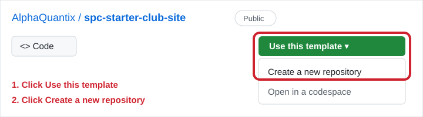
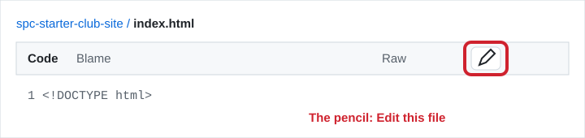
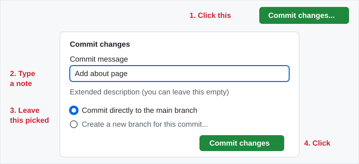
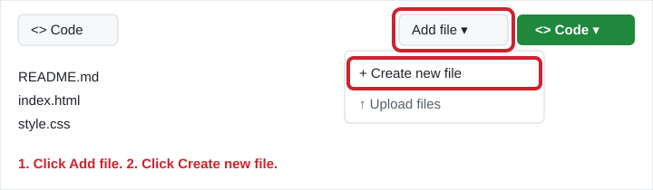

# SPC Photography Club: a starter website

This is the starter for project kit **PRJ-FE-01: A site for a college club or event**.

You will build a small website for a club. It will work on a phone. It will have a contact form. The club is made up. Its name is the SPC Photography Club.

You only need a web browser and a GitHub account. You do not need to install anything. You do all the work on the GitHub website.

## Words you will see

- **HTML** is the text of a web page. It says what is on the page: headings, paragraphs, links and pictures. HTML files end in `.html`.
- **CSS** says how the page looks: colours, sizes and where things sit. CSS files end in `.css`.
- **JavaScript** makes the page do things when you click or type. JavaScript files end in `.js`.
- A **repository** (or "repo") is a project folder on GitHub. It holds all the files of your site and a list of every change.
- A **branch** is one line of changes in a repository. Your copy has one branch, called **main**. Your live site is built from it.
- A **commit** is one saved change, with a short note that says what changed.

## What is here now

- `index.html` is the home page. It has a heading, a welcome note and three cards.
- `style.css` sets the colours, sizes and layout.
- `script.js` is empty for now. You will fill it in feature 3.
- `images/` holds six practice pictures. You will use them in the stretch task.
- `guide/` has a step guide for each feature.

The site is not finished. It has one page only. It does not work well on a phone. It has no form. You will fix all three.

## What you will build

| Step | Feature | Guide |
|---|---|---|
| 1 | Three linked pages | [guide/01-feature-1.md](guide/01-feature-1.md) |
| 2 | Works on a phone | [guide/02-feature-2.md](guide/02-feature-2.md) |
| 3 | A contact form | [guide/03-feature-3.md](guide/03-feature-3.md) |
| Extra | Add a gallery page | [guide/stretch.md](guide/stretch.md) |

Do them in order. Each one takes about 45 minutes or less.

## Start here: make your own copy

Only one person in your team does this part.

1. Sign in to GitHub.
2. At the top of this page, click the green **Use this template** button.
3. Click **Create a new repository**.

   

   If you do not see a **Use this template** button, you may not be signed in. Sign in and look again. If it is still not there, ask your mentor. Do not click **Fork** instead.
4. Under **Owner**, pick your own account.
5. In **Repository name**, type a short name in small letters, for example `club-site`.
6. Pick **Public**. GitHub Pages needs a public repository on a free account.
7. Leave **Include all branches** turned off. You only need the main branch.
8. Click **Create repository**.

You now have your own copy. All the steps in the guides happen in your copy, not in this one.

## Add your teammate

1. In your copy, click the **Settings** tab at the top. It has a gear icon.
2. In the menu on the left, click **Collaborators**.
3. Click **Add people**. Type your teammate's GitHub user name. Click to add them.
4. Your teammate gets an email. They must click **Accept invitation**.

Now you can both make changes. Take turns. One person types. The other reads the steps out loud and checks the work.

## Put your site live with GitHub Pages

1. In your copy, click the **Settings** tab.
2. In the menu on the left, click **Pages**.
3. Under **Build and deployment**, find **Source**. Pick **Deploy from a branch**.
4. Under **Branch**, pick **main**. In the box next to it, pick **/ (root)**.
5. Click **Save**.
6. Wait one or two minutes. Then refresh the page.
7. At the top you will see **Your site is live at** and a link. Click **Visit site**.

Your link looks like this: `https://your-user-name.github.io/club-site/`

Each time you save a change, the live site updates in a minute or two. To see a change, refresh the page. If you still see the old page, hold **Shift** and click refresh.

You can watch the update happen. Click the **Actions** tab. It lists the jobs GitHub runs for you, such as putting your site live. A yellow dot means it is still working. A green tick means it is done.

## How to make a change on GitHub

You will do these two things again and again.

**Change a file**

1. Click the **Code** tab. You will see a list of files.
2. Click the name of the file.
3. Click the pencil icon near the top right. Its label is **Edit this file**.

   
4. Make your change in the big text box.
5. Click the green **Commit changes...** button at the top right.
6. In **Commit message**, type a short note about what you changed.
7. Leave **Commit directly to the main branch** picked.
8. Click **Commit changes**.

   

**Make a new file**

1. Click the **Code** tab.
2. Click the **Add file** button. Then click **Create new file**.

   

3. In the **Name your file...** box, type the file name.
4. Type or paste the file's code in the big box.
5. Commit it the same way as above.

A commit is a saved change with a note. A good commit note says what you changed. Start it with a verb. For example: `Add about page`. A bad note is `update` or `stuff`.

## See the finished version

Our own finished site is live at https://alphaquantix.github.io/spc-starter-club-site/

It shows what your site can look like when you are done. Try to build yours from the guides before you look at it.

The pictures in the guides are simple drawings, not exact copies of the screen. GitHub sometimes moves a button a little. Look for the same words on the button.

## Rules for this project

- Use plain HTML, CSS and JavaScript only. Do not add any other tools.
- Use made-up names and emails when you test the form. For example: `Asha Example` and `asha@example.com`.
- Do not post photos of people unless they said yes.

## For staff: how this repository must be set up

Students do not need this part. It is for the people who look after this repository.

- **Template:** in **Settings**, under **General**, tick **Template repository**. Without it, the **Use this template** button does not appear.
- **Public:** the repository must be public, or students cannot see the button.
- **Two branches:** `main` is the starter and the guides. `demo` is the finished site, with one commit per feature.
- **Our demo site:** in **Settings**, then **Pages**, set **Source** to **Deploy from a branch** and **Branch** to **demo**, **/ (root)**. That is what is live at https://alphaquantix.github.io/spc-starter-club-site/. Students set their own copy to **main**, as the steps above say, because their copy has only the main branch.

## Licence

MIT. See [LICENSE](LICENSE). Made by AlphaQuantix Analytics LLP.
